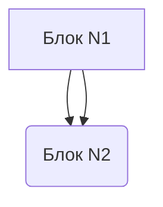

$$ \Large
\sum_{k=1} k
$$



<!-- yggdrasil-mermaid:{"version":1,"id":"89f7a9a3-6eca-4e9a-899c-08f1ada2128a","positions":{"N1":{"x":4,"y":318},"N2":{"x":282,"y":152}},"handles":{"e:N1:N2:0":{"source":"source-right","target":"source-left"},"e:N1:N2:1":{"source":"source-left","target":"source-top"}},"lastValidSource":"flowchart TD\n    N1[\"Блок N1\"]\n    N2(\"Блок N2\")\n    N1 --\u003e N2\n    N1 --\u003e N2","viewport":{"x":125,"y":26.5,"zoom":1,"width":742,"height":731}} -->


```quiz
{
  "version": 1,
  "id": "5309ea62-586d-4925-9329-765aab0e5aea",
  "title": "Тест",
  "questions": [
    {
      "id": "fba2ec67-d917-4432-957d-96d4f880caea",
      "text": "шнпп",
      "type": "single",
      "options": [
        {
          "id": "e58125b7-3fdc-457d-bfea-c3edb6b54e89",
          "text": "655"
        },
        {
          "id": "5e4de2de-92ac-44c9-b643-85580da6e381",
          "text": "5675"
        }
      ],
      "correct": [
        "e58125b7-3fdc-457d-bfea-c3edb6b54e89"
      ]
    },
    {
      "id": "da690ce5-0a0b-44e1-819d-89cf02f348cc",
      "text": "гнгне",
      "type": "multiple",
      "options": [
        {
          "id": "ae426b16-8091-4a30-ab54-fabe3a3b3e34",
          "text": "егннге"
        },
        {
          "id": "41acb4be-dcd5-4c82-b62d-23b010d5c873",
          "text": "гегннг"
        },
        {
          "id": "8c03a8b6-9a16-4cd6-8715-eec88147d0a3",
          "text": "ь"
        }
      ],
      "correct": [
        "ae426b16-8091-4a30-ab54-fabe3a3b3e34",
        "41acb4be-dcd5-4c82-b62d-23b010d5c873"
      ]
    }
  ]
}
```
